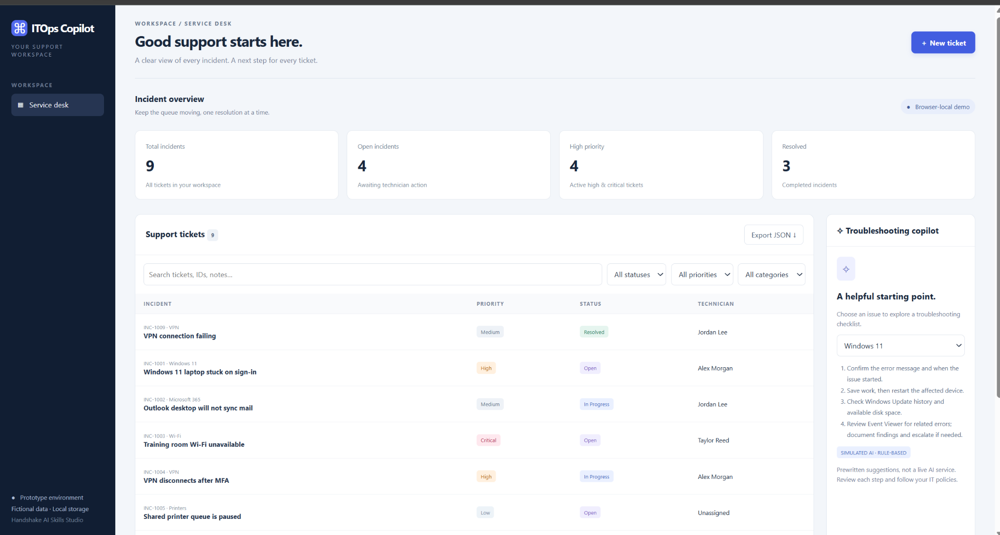

# ITOps Copilot — IT Service Desk & Incident Management

**Interactive, browser-based IT service desk prototype** created as part of Handshake AI Skills Studio's *Turn an Idea into a Working Prototype* mission.

**[Try the live demo](https://frolicking-concha-79c88d.netlify.app)**



## Why I built it

IT support teams need a clear way to document incidents, prioritize requests, assign technicians, and retain a record of decisions. I built this project to practice the support-ticket lifecycle, technical documentation, and troubleshooting workflows applicable to IT Support, Application Support, and IT Operations roles.

## Features

- **Incident dashboard:** total, open, active high/critical, and resolved ticket counts.
- **Ticket lifecycle:** create and edit incidents, set category and priority, update status, and assign a fictional technician.
- **Ticket Activity Timeline:** timestamped changes to status, priority, and technician assignment, plus troubleshooting notes.
- **Search and filters:** filter by status, priority, category, or search ticket content.
- **Troubleshooting reference:** prewritten checklists for Windows 11, Microsoft 365, Wi-Fi, VPN, printers, and applications.
- **Local persistence:** browser `localStorage` preserves demo edits across page refreshes in the same browser context.
- **JSON export:** download a copy of the current demo tickets.
- **Responsive layout:** desktop dashboard with smaller-screen adjustments.

## Tech stack

- HTML5 — app structure and forms
- CSS3 — dashboard, ticket details, responsive layout
- Vanilla JavaScript — ticket CRUD, filtering, timeline, local storage, and JSON export
- Netlify — static website hosting
- ChatGPT Work / Handshake AI Skills Studio — AI-assisted prototyping and iterative improvement

> **Scope and honesty:** This is a single-page **prototype**, not a production ITSM platform. The panel named “Troubleshooting copilot” offers **rule-based/prewritten suggestions**, not responses from a live AI model. The app uses fictional sample tickets. It has **no backend database, authentication, shared accounts, real ticket system, enterprise integrations, or access-control enforcement**. Saved tickets are specific to one browser/local origin; other visitors see their own independent dataset.

## Run locally

1. Download this repository as a ZIP, or clone it:
   ```bash
   git clone https://github.com/kesha1104/itops-copilot-service-desk.git
   ```
2. Open `index.html` in a current browser (Chrome or Edge). No installation, npm packages, Python runtime, or API keys required.
3. Click **+ New ticket** to create a fictional support request.

You can also use the hosted [live demo](https://frolicking-concha-79c88d.netlify.app).

## Sample test scenario

1. Create an incident titled **VPN connection failing**, category **VPN**, priority **High**, and status **Open**.
2. Save; verify the total incident count increases.
3. Reopen; change status to **In Progress** and record a **simulated** diagnostic note.
4. Reopen; change status to **Resolved**, reduce priority to **Medium**, and reassign to another fictional technician.
5. Reopen; confirm the Ticket Activity Timeline shows the field changes and notes.
6. Refresh the browser and check the incident is still present.
7. Search for the incident, filter **Resolved**, and export the dataset to JSON.

For a broader QA checklist, see [TESTING.md](TESTING.md).

## Repository layout

```text
itops-copilot-service-desk/
├── index.html                  # Complete standalone app
├── README.md                   # Project documentation
├── TESTING.md                  # Manual functional test checklist
├── .gitignore                  # Files excluded from source control
├── LICENSE                     # MIT license
└── screenshots/
    └── dashboard.png           # Screenshot of real demo UI
```

## Design decisions

- **Static, dependency-free deployment:** a single HTML file simplifies distribution and rapid demos.
- **Browser-local persistence:** supports practice workflows without a server, but is not suitable for shared enterprise ticketing.
- **Event history:** status, priority, and technician changes are stored with timestamps to illustrate a simplified ticket audit trail.
- **Explicit labeling:** simulated data and rule-based recommendations are identified in the UI to avoid implying real system access.

## Future improvements

- Flask or another backend API with PostgreSQL for shared ticket storage.
- Authentication and authorization suitable for actual multiuser workflows.
- Import JSON with schema validation and safe recovery of saved test data.
- Automated tests, accessibility review, and stronger form validation.
- Optional AI-assisted knowledge-base suggestions with citations, confidence checks, and human review.

## Project context

Built as a **Handshake AI Skills Studio** prototype with iterative testing and refinements. The initial version supported ticket operations; a later version introduced a timestamped Ticket Activity Timeline. See the [live demo](https://frolicking-concha-79c88d.netlify.app) for the currently published application.
